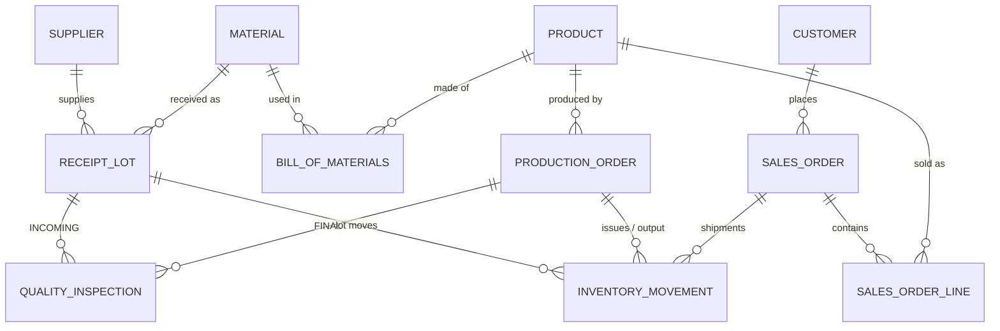

# Manufacturing & Supply Chain Analytics — Advanced SQL Project

*Leer en español: [README.es.md](README.es.md)*

A personal portfolio project built with **SQL Server (T-SQL)**. It models **NovaLeaf Manufacturing**, a
**fictional** producer of herbal tea boxes, and follows its data from suppliers to customers:

```
Suppliers ─► Receipt lots ─► Incoming inspection ─► Inventory ─► Production orders ─► Final inspection ─► Sales
```

All data is fictional and intentionally small (Jan–Mar 2025, 4–54 rows per table) so every number can be
checked by hand. It is a learning and portfolio project, **not** a production system.

## Project status

| Stage | Content | Status |
|---|---|---|
| 1 | Source model, landing tables, seed data with planted quality issues | ✅ Done, tested |
| 2 | Typed staging layer, cleaning rules, quarantine, cross-process data quality checks, automated tests | ✅ Done, tested |
| 3 | Dimensional model (facts, dimensions, surrogate keys) | 🔜 Next |
| 4 | KPI queries: production, quality, inventory, suppliers, sales (window functions, CTEs) | Planned |
| 5 | Incremental load + idempotency demo, SCD Type 2 | Planned |
| 6 | Optional Power BI dashboard, translation of selected queries to PostgreSQL / Databricks SQL | Planned |

## Architecture

```
 land  (raw extracts, all NVARCHAR, no constraints)
   │   etl.usp_load_staging: TRIM/UPPER, TRY_CONVERT, ROW_NUMBER dedup, reject rules
   ▼
 stg   (typed tables with PK / FK / CHECK)  ──►  dq.rejected_rows (quarantine, original row as JSON)
   │   dq.usp_run_checks: reconciliation between processes
   ▼
 dq.check_result (PASS / FAIL / WARN per check, history per run)
   ▼
 dw    (dimensional model — stage 3)
```

These are **schemas inside one SQL Server database**. The idea is similar to the Bronze/Silver/Gold layers
of a lakehouse Medallion architecture, but it is not the same thing: there is no file storage, no Delta
tables and no separation of storage and compute. See [docs/decisions_and_limitations.md](docs/decisions_and_limitations.md).

## Source data model (staging)



Table grain, keys and units: [docs/data_dictionary.md](docs/data_dictionary.md).

## Data quality: what the pipeline detects

The seed data contains 15 planted issues ([docs/data_quality_catalog.md](docs/data_quality_catalog.md)).
Current, reproducible output of `EXEC dq.usp_run_checks`:

| Check | Severity | Failed rows | Root cause in the data |
|---|---|---|---|
| C01 Staging counts reconcile with load log | ERROR | 0 | — |
| C02 Each lot has exactly one RECEIPT movement | ERROR | **1** | LOT-2513 was received but never posted to inventory |
| C03 Receipt qty equals lot qty | ERROR | 0 | — |
| C04 No negative lot balance | ERROR | **1** | Same root cause: LOT-2513 bags consumed without a receipt |
| C05 Production output equals produced_qty | ERROR | 0 | — |
| C06 Shipments reconcile with order lines | ERROR | **1** | SO-5005 shipped, but its line was quarantined (ambiguous discount) |
| C07 Material issued from a lot not approved | WARNING | **1** | LOT-2507 failed incoming inspection and was used in PO-1004 |
| C08 Production end before start | WARNING | **1** | PO-1006 timestamps swapped |
| C09 Shipped before ordered | WARNING | **1** | SO-5006 |
| C10 Completed order without passing final inspection | WARNING | 0 | — |
| C11 Rows quarantined | WARNING | **5** | See catalog |

## How to run

Requirements: SQL Server 2019 or later (developed and tested on **SQL Server 2022 Developer**, also run
under compatibility level 150) and SSMS. Setup guide for Windows: [docs/setup_windows.md](docs/setup_windows.md).

1. Open `sql/run_all.sql` in SSMS, enable **Query → SQLCMD Mode**, edit `ProjectPath`, press F5.
   *Or* run the files in `sql/` in numeric order.
2. Run `tests/test_stage2_expected_results.sql`. Expected last line: `ALL STAGE 2 TESTS PASSED`.

## Repository structure

```
novaleaf-manufacturing/
├── sql/
│   ├── 00_create_database.sql        # (re)creates the NovaLeaf database
│   ├── 01_create_schemas.sql         # land, stg, etl, dq
│   ├── 02_create_landing_tables.sql  # raw extracts, all text
│   ├── 03_seed_landing_data.sql      # fictional data with planted issues
│   ├── 04_create_staging_tables.sql  # typed tables + constraints
│   ├── 05_create_etl_objects.sql     # load log, quarantine, etl.usp_load_staging
│   ├── 06_create_dq_checks.sql       # dq.usp_run_checks
│   ├── 07_run_pipeline.sql           # runs load + checks
│   └── run_all.sql                   # SQLCMD script that runs 00-07
├── tests/
│   └── test_stage2_expected_results.sql
└── docs/
    ├── data_dictionary.md
    ├── data_quality_catalog.md
    ├── decisions_and_limitations.md
    ├── business_questions.md
    └── setup_windows.md
```

## Scope and honesty notes

- Personal portfolio project with fictional data. It does not describe any real company.
- Results on this small dataset demonstrate **correctness**, not performance or scalability.
- Performance work (indexes, execution plans) will only report improvements that were actually measured.
